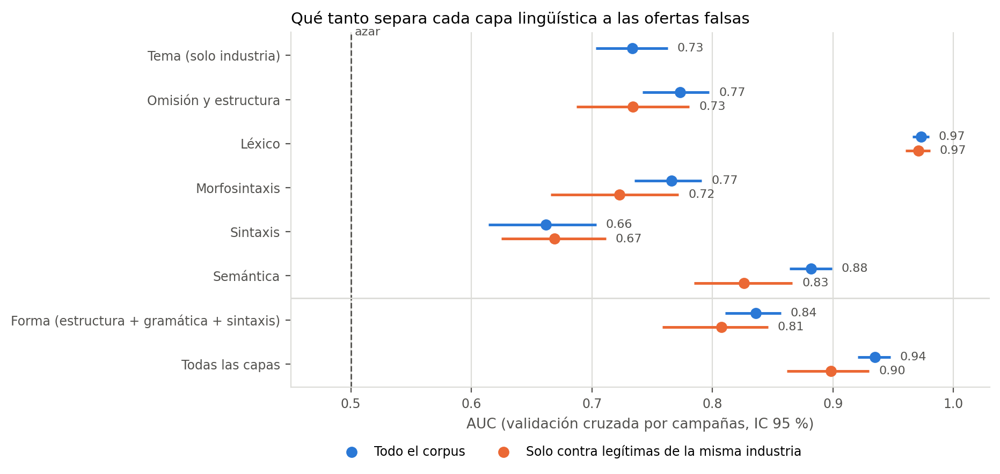
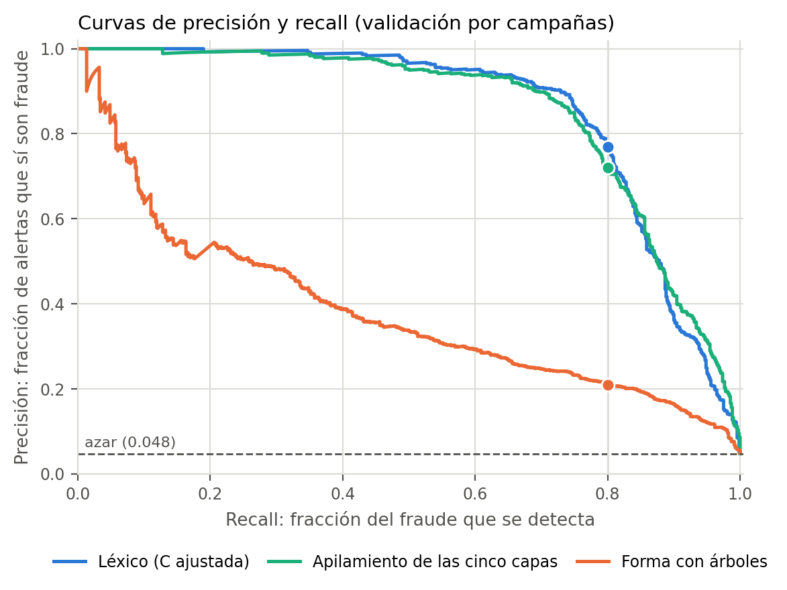
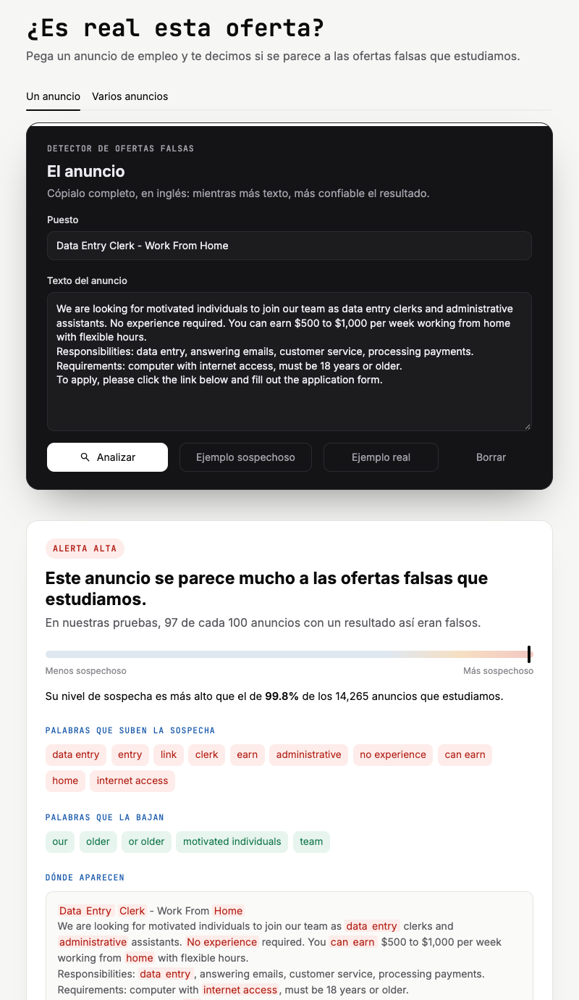

# Detección de ofertas de empleo fraudulentas a partir del lenguaje

**Un estudio de PLN sobre el corpus EMSCAD: un detector por capas lingüísticas, evaluado con control de industria y de anuncios copiados.**

[English version](README.md) · [Artículo completo (PDF)](paper/articulo_deteccion_fraude_EMSCAD.pdf) · [Cuaderno final](notebooks/06_detector_fraude.ipynb)

---

## Resumen

- Construí un detector de ofertas de empleo fraudulentas que usa **solo el texto del anuncio**. Cada anuncio se representa con **cinco capas lingüísticas**: omisión y estructura, léxico TF-IDF, morfosintaxis, sintaxis de dependencias y vectores semánticos.
- La evaluación habitual de EMSCAD, con particiones al azar, **está inflada**. El 36 % de las ofertas falsas de prueba tiene en el entrenamiento una copia de su misma campaña. Además, la industria por sí sola, sin leer el anuncio, ya da un AUC de 0.73. Diseñé una evaluación que controla los dos problemas.
- **Mejor detector (léxico, regresión logística ajustada): AUC 0.98 y precisión promedio 0.85** con validación cruzada por campañas. Detecta el **80 % del fraude con precisión de 0.77** (707 alertas en 14,265 anuncios) y la mitad con 0.97.
- La señal **no es el sector**. El detector conserva un AUC de 0.97 dentro de la misma industria y de 0.89 en industrias que nunca vio. Lo que aprende es el *tipo de empleo que se ofrece como anzuelo*: trabajo de oficina sin requisitos (`data entry`, `administrative`, `clerk`) con la promesa de ganar dinero (`earn`).
- Los vectores semánticos son la capa más frágil: su AUC **cae a 0.38 en Oil & Energy**, porque el fraude imita el tema de su sector.

## Problema

Las ofertas de empleo falsas buscan obtener datos personales o dinero de quien se postula. EMSCAD (Vidros et al., 2017) es el conjunto de datos público de referencia: 17,880 anuncios reales de la plataforma Workable, etiquetados a mano como legítimos o fraudulentos. Durante el semestre encontré dos motivos para desconfiar de los resultados altos que se reportan con él:

1. **Atajo del tema.** El fraude se concentra en pocos sectores, y las palabras más distintivas del fraude eran `aker`, `subsea` y `petroleum`. Un modelo puede aprender a reconocer anuncios petroleros en lugar de anuncios engañosos (*shortcut learning*, Geirhos et al., 2020).
2. **Fuga por copias.** Una quinta parte del corpus eran anuncios repetidos, y las campañas de estafa publican la misma plantilla decenas de veces con cambios menores. Una partición al azar pone casi copias en entrenamiento y en prueba (*leakage*, Kaufman et al., 2012).

## Método

| Paso | Qué hice |
|---|---|
| Limpieza | Quité HTML, marcadores de anonimización y variantes tipográficas, y eliminé copias exactas: 17,880 → **14,265 anuncios (680 fraudulentos, 4.8 %)** |
| Campañas | Uní los anuncios con coseno ≥ 0.95 entre sus vectores MiniLM. Las componentes conexas dan **10,300 campañas**, y los 680 fraudes se reducen a 506 |
| Capas de rasgos | Omisión y estructura (9), TF-IDF de palabras y bigramas (60 mil), morfosintaxis con etiquetas de NLTK (18), sintaxis de dependencias con spaCy (8), `all-MiniLM-L6-v2` (384) y una referencia que solo conoce la industria |
| Modelo | Regresión logística L2 con pesos balanceados por capa. Después, ajuste anidado de C, apilamiento de las cinco capas y *gradient boosting* con los 35 rasgos de forma |
| Control de copias | Validación cruzada de 5 pliegues en tres versiones: al azar, **por campañas** y por plantillas (más estricta) |
| Control de tema | **AUC dentro de industria**, que compara cada oferta falsa solo con las legítimas de su sector (un "detector de sector" obtiene 0.5), y **prueba dejando fuera una industria** en las cinco que tienen al menos 25 fraudes |
| Incertidumbre | Intervalos al 95 % con 500 remuestras *bootstrap* **de campañas completas** |

## Resultados



| Capa | AUC (CV por campañas) | AUC dentro de industria | AUC en industria no vista (promedio de 5) | Precisión promedio |
|---|---|---|---|---|
| Solo industria (referencia) | 0.73 | — | — | 0.18 |
| Omisión y estructura | 0.77 | 0.73 | 0.76 | 0.15 |
| **Léxico (TF-IDF)** | **0.97** | **0.97** | **0.89** | **0.83** |
| Morfosintaxis | 0.77 | 0.72 | 0.70 | 0.13 |
| Sintaxis | 0.66 | 0.67 | 0.63 | 0.11 |
| Semántica (MiniLM) | 0.88 | 0.83 | 0.74 | 0.39 |
| Forma (estructura + gramática + sintaxis, 35 rasgos) | 0.84 | 0.81 | 0.81 | 0.20 |

**Detector final.** Al ajustar la regularización, el léxico sube a AUC 0.976 y PP 0.854. El apilamiento de las cinco capas (0.980 / 0.851) no lo supera, así que se recomienda el modelo más simple. Con *gradient boosting*, los 35 rasgos de forma llegan a AUC 0.91 (PP de 0.20 a 0.38). Sirven de complemento cuando el vocabulario cambia, pero no bastan como detector único.



| Detector léxico, punto de operación | Alertas | Fraudes detectados | Falsas alarmas | Precisión |
|---|---|---|---|---|
| 53 % del fraude | 370 | 358 | 12 | 0.97 |
| 80 % del fraude | 707 | 544 | 163 | 0.77 |
| 90 % del fraude | 1,631 | 612 | 1,019 | 0.38 |

**Cuánto inflan las copias.** Al pasar de la validación al azar a la validación por plantillas, el AUC casi no cambia. La precisión promedio, en cambio, cae mucho en las capas de contenido: léxico de 0.87 a 0.72 y semántica de 0.46 a 0.32. La forma casi no se mueve (0.22 a 0.20). Parte del buen resultado de las capas de contenido consiste en reconocer plantillas ya vistas.

### Lo que aprendí (incluido en qué me equivoqué)

- **Una de mis hipótesis resultó falsa.** Después del análisis exploratorio esperaba que el léxico se viniera abajo al controlar la industria, pero no fue así. Las palabras *más distintivas* sí miden sector, pero un modelo supervisado encuentra otra señal que cruza sectores: el empleo anzuelo.
- **El fraude se delata por omisión.** El 67 % de las ofertas falsas omite el perfil de la empresa, frente al 19 % de las legítimas. También son más cortas (mediana de 247 contra 381 palabras) y tienen oraciones más cortas, menos profundas y con menos subordinadas, algo que se cumplió en las cuatro industrias analizadas.
- **Algunas "señales de alerta" populares no se sostienen.** Conceptos típicos de estafa como "trabajo desde casa" tienen un AUC de alrededor de 0.48 por sí solos. El mayor uso de `your` y `must` en las ofertas falsas deja de ser significativo con *bootstrap* de campañas.

## Estructura

El proyecto se construyó en seis cuadernos. Cada uno parte de los artefactos de los anteriores.

| Cuaderno | Tema | Técnicas principales |
|---|---|---|
| [`01_construccion_corpus`](notebooks/01_construccion_corpus.ipynb) | Construcción del corpus | Limpieza de HTML, eliminación de duplicados, tokenización con NLTK, vocabulario |
| [`02_analisis_estadistico`](notebooks/02_analisis_estadistico.ipynb) | Análisis estadístico | Zipf, n-gramas, diversidad léxica normalizada, análisis por posición |
| [`03_morfosintaxis`](notebooks/03_morfosintaxis.ipynb) | Morfosintaxis | Etiquetado POS, lematización con WordNet, comparaciones dentro de industria |
| [`04_sintaxis_dependencias`](notebooks/04_sintaxis_dependencias.ipynb) | Sintaxis | Gramática de constituyentes con expresiones regulares, dependencias con spaCy |
| [`05_semantica_embeddings`](notebooks/05_semantica_embeddings.ipynb) | Semántica | Word2Vec, FastText, Sentence-BERT, BERT contextual, detección de campañas |
| [`06_detector_fraude`](notebooks/06_detector_fraude.ipynb) | **Proyecto final: el detector** (se lee como el artículo: primero texto, figuras y tablas; todo el código en el Anexo A) | Capas de rasgos, CV agrupada, AUC dentro de industria, industria fuera, apilamiento, *gradient boosting* |

## Interfaz web

Una interfaz en Streamlit permite pegar un anuncio y ver el resultado, su posición frente al corpus y qué palabras subieron o bajaron la sospecha (resaltadas en el texto). También puntúa un CSV completo.

```bash
pip install -r requirements.txt
streamlit run app.py
```



## Probar el detector

El detector final ya entrenado (léxico TF-IDF + regresión logística, C = 10) está en `modelos/detector_lexico.joblib`, así que se pueden puntuar anuncios nuevos sin ejecutar los cuadernos:

```bash
python scripts/detector.py probar --archivo ejemplos/anuncio_sospechoso.txt
python scripts/detector.py probar --texto "Senior Backend Engineer. We build..."
python scripts/detector.py probar --csv ejemplos/anuncios.csv   # title, company_profile, description, requirements, benefits
```

Para cada anuncio da un nivel de alerta, su posición frente al corpus y los términos que subieron o bajaron el puntaje. Los umbrales son los de la Tabla 8 del artículo (53 % del fraude con precisión de 0.97 y 80 % con 0.77), calculados con validación cruzada por campañas. `python scripts/detector.py entrenar` lo vuelve a entrenar desde `corpus_procesado/` en unos 40 s y reproduce el AUC de 0.976 y la precisión promedio de 0.854. El modelo solo lee inglés, los anuncios de `ejemplos/` los inventé para la demostración y el archivo `.joblib` se guardó con scikit-learn 1.9.1.

## Cómo reproducir

```bash
git clone https://github.com/leocarpio16/fraudulent-job-postings-nlp.git
cd fraudulent-job-postings-nlp
pip install -r requirements.txt
python -m spacy download en_core_web_sm
python scripts/descargar_datos.py      # descarga EMSCAD de Kaggle a notebooks/
```

Después hay que ejecutar los cuadernos en orden **desde la carpeta `notebooks/`**. El 01 guarda el corpus procesado en `notebooks/corpus_procesado/` y los demás lo leen de ahí. Los recursos de NLTK y los modelos de Hugging Face se descargan solos la primera vez. Tiempos aproximados en una MacBook con Apple M1 y 8 GB de RAM: unos 25 min para los cuadernos 01 a 05 (casi todo en dependencias y vectores) y unos 14 min para el 06. La semilla es 42.

Los datos no se redistribuyen. Provienen de [Vidros et al. (2017)](https://doi.org/10.3390/fi9010006) y están en Kaggle como [`amruthjithrajvr/recruitment-scam`](https://www.kaggle.com/datasets/amruthjithrajvr/recruitment-scam). El script comprueba el MD5 del archivo.

## Características del estudio y limitaciones

El artículo las presenta al inicio (sección 3.1) para fijar el marco del estudio, y en la sección 7.3 cuantifica el efecto de cada una y propone cómo mitigarla.

- Solo hay 680 ofertas falsas en 506 campañas, así que los resultados por industria son tendencias con intervalos amplios.
- El 29 % de los anuncios no declara industria, y ese campo lo elige quien publica.
- El umbral de campaña (coseno 0.95) es una decisión de diseño. Una plantilla reescrita por completo todavía puede filtrarse.
- Un solo corpus: inglés, una plataforma, 2012 a 2014. No sé cómo se comporta con estafas actuales.
- Los umbrales de operación se eligieron con los mismos puntajes con que se reportan, así que son optimistas.
- El detector sirve para **priorizar la revisión humana, no para bloquear anuncios**. Un empleo legítimo de captura de datos o de asistente puede recibir un puntaje alto.

## Autor

**Leo Yahir Carpio Ángeles**. Proyecto semestral de Procesamiento de Lenguaje Natural, noviembre de 2026.
