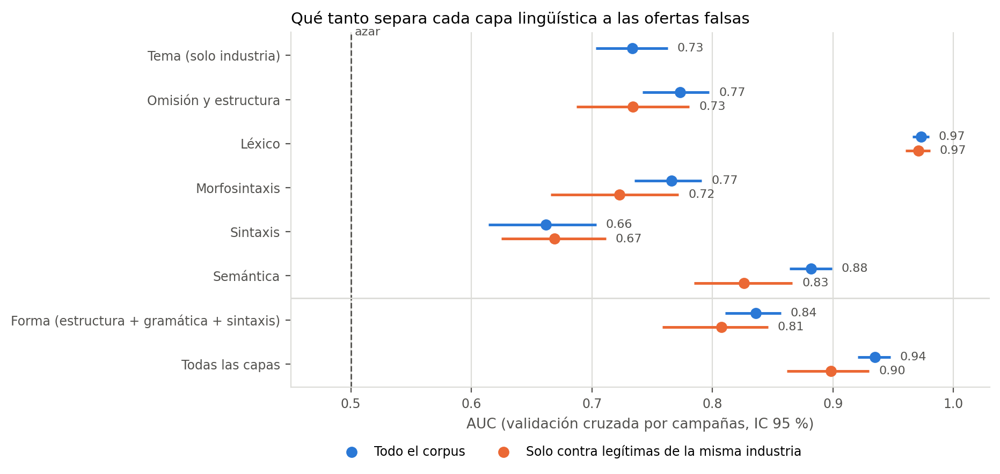
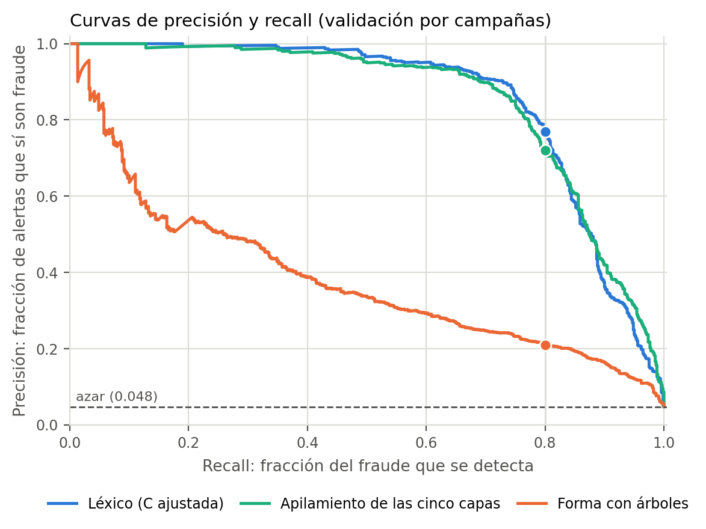

# Detecting fraudulent job postings from language

**An NLP study on the EMSCAD corpus: a layered linguistic detector, evaluated with controls for industry and for copy-pasted ads.**

[Versión en español](README.es.md) · [Full paper (PDF, Spanish)](paper/articulo_deteccion_fraude_EMSCAD.pdf) · [Final notebook](notebooks/06_detector_fraude.ipynb)

    

---

## TL;DR

- Built a fraud detector for online job ads using **only the text of the ad**, and represented each ad with **five linguistic layers** (omission/structure, TF-IDF lexicon, morphosyntax, dependency syntax, sentence embeddings).
- The usual random-split evaluation on EMSCAD is **inflated**. 36 % of fraudulent test ads have a copy from the same campaign in the training set. Industry alone, without reading a single word, already gets an AUC of 0.73. I designed an evaluation that controls for both problems.
- **Best detector (lexical, tuned logistic regression): AUC 0.98, average precision 0.85** with campaign-grouped CV. It catches **80 % of fraud at 0.77 precision** (707 alerts out of 14,265 ads) and half of it at 0.97.
- The signal is **not the industry**. The detector keeps an AUC of 0.97 within the same industry and 0.89 on industries it never saw. What it learned is the *type of job used as bait*: unskilled office work (`data entry`, `administrative`, `clerk`) paired with promises to `earn` money.
- Sentence embeddings are the most fragile layer: their AUC **drops to 0.38 in Oil & Energy**, because fake ads imitate the topic of their sector.

## The problem

Fake job postings are used to steal personal data or money from applicants. EMSCAD (Vidros et al., 2017) is the standard public benchmark: 17,880 real ads from the Workable platform, hand-labelled as legitimate or fraudulent. Simple classifiers report very high accuracy on it. Over a semester of analysis I found two reasons to distrust those numbers:

1. **Topic shortcut.** Fraud is concentrated in a few sectors (Oil & Energy, Accounting, Health Care). The most distinctive "fraud words" were `aker`, `subsea` and `petroleum`. A model can learn to spot oil-industry ads instead of deceptive ones (*shortcut learning*, Geirhos et al., 2020).
2. **Leakage through copies.** About a fifth of the corpus were duplicates, and scam campaigns repost the same template dozens of times with small changes. A random train/test split puts near-copies on both sides (*leakage*, Kaufman et al., 2012).

## Approach

| Step | What I did |
|---|---|
| Cleaning | Stripped HTML, anonymisation tokens and typographic variants, then removed exact duplicates: 17,880 → **14,265 ads (680 fraudulent, 4.8 %)** |
| Campaigns | Linked ads whose MiniLM embeddings have cosine ≥ 0.95. Connected components give **10,300 campaigns**, and the 680 fraudulent ads collapse into 506 |
| Feature layers | Omission & structure (9), TF-IDF unigrams + bigrams (60k), morphosyntax with NLTK POS tags (18), dependency syntax with spaCy (8), `all-MiniLM-L6-v2` document embeddings (384), plus an *industry-only* baseline |
| Model | L2 logistic regression with balanced class weights per layer. Then nested CV to tune C, stacking of the five layers, and histogram gradient boosting on the 35 content-free "form" features |
| Leakage control | 5-fold CV in three variants: random, **grouped by campaign**, and grouped by shared template sentences (stricter) |
| Topic control | **Within-industry AUC** (each fake ad is compared only with legitimate ads from its own industry, so a pure "sector detector" scores 0.5) and **leave-one-industry-out** testing on the five industries with ≥ 25 frauds |
| Uncertainty | 95 % CIs from 500 bootstrap resamples **of whole campaigns** |

## Results



| Layer | AUC (campaign CV) | AUC within industry | AUC on unseen industry (mean of 5) | Average precision |
|---|---|---|---|---|
| Industry only (baseline) | 0.73 | — | — | 0.18 |
| Omission & structure | 0.77 | 0.73 | 0.76 | 0.15 |
| **Lexical (TF-IDF)** | **0.97** | **0.97** | **0.89** | **0.83** |
| Morphosyntax | 0.77 | 0.72 | 0.70 | 0.13 |
| Syntax | 0.66 | 0.67 | 0.63 | 0.11 |
| Semantic (MiniLM) | 0.88 | 0.83 | 0.74 | 0.39 |
| Form (structure + grammar + syntax, 35 features) | 0.84 | 0.81 | 0.81 | 0.20 |

**Final detector.** Tuning regularisation raises the lexical model to AUC 0.976 / AP 0.854. Stacking all five layers (0.980 / 0.851) does not beat it, so the simpler model is the recommended one. Gradient boosting on the 35 form features reaches AUC 0.91 (AP 0.20 → 0.38). That makes it a useful complement when vocabulary shifts, but it does not work as a detector on its own.



| Lexical detector, operating point | Alerts | Frauds caught | False alarms | Precision |
|---|---|---|---|---|
| 53 % recall | 370 | 358 | 12 | 0.97 |
| 80 % recall | 707 | 544 | 163 | 0.77 |
| 90 % recall | 1,631 | 612 | 1,019 | 0.38 |

**How much copies inflate results.** Going from a random split to template-grouped CV, the AUC barely moves, but average precision drops sharply for the content layers: lexical 0.87 → 0.72, semantic 0.46 → 0.32. Form features stay flat (0.22 → 0.20). Part of what makes content models look good is recognising templates they have already seen.

### What I learned (including where I was wrong)

- **One of my hypotheses was refuted.** After the exploratory phase I expected the lexical layer to collapse once industry was controlled, but it did not. The *most distinctive* words do measure sector. A supervised model, though, finds a different, cross-sector signal: the bait job.
- **Fraud is revealed by omission.** 67 % of fake ads leave out the company profile, compared with 19 % of legitimate ones. Fake ads are also shorter (median 247 vs. 381 words) and use shorter, shallower sentences with fewer subordinate clauses. This held in all four industries I checked.
- **Some popular "red flags" don't hold up.** Scam-typical concepts such as "work from home" score an AUC of about 0.48 as single cues. The extra `your` and `must` in fake ads stop being significant once the bootstrap resamples whole campaigns.

## Project structure

The project grew over six notebooks. Each one builds on the artefacts of the previous ones.

| Notebook | Topic | Main techniques |
|---|---|---|
| [`01_construccion_corpus`](notebooks/01_construccion_corpus.ipynb) | Corpus construction | HTML cleaning, deduplication, sentence/word tokenisation (NLTK), vocabulary |
| [`02_analisis_estadistico`](notebooks/02_analisis_estadistico.ipynb) | Statistical analysis | Zipf, n-grams, normalised lexical diversity, positional analysis |
| [`03_morfosintaxis`](notebooks/03_morfosintaxis.ipynb) | Morphosyntax | POS tagging, WordNet lemmatisation, within-industry comparisons |
| [`04_sintaxis_dependencias`](notebooks/04_sintaxis_dependencias.ipynb) | Syntax | Regex constituency grammar, spaCy dependency parsing, tree depth |
| [`05_semantica_embeddings`](notebooks/05_semantica_embeddings.ipynb) | Semantics | Word2Vec, FastText, Sentence-BERT, contextual BERT, campaign detection |
| [`06_detector_fraude`](notebooks/06_detector_fraude.ipynb) | **Final project: the detector** (reads like the paper: text, figures and tables first, all code in Annex A) | Layered features, grouped CV, within-industry AUC, leave-one-industry-out, stacking, gradient boosting |

```
├── notebooks/            # 6 executed notebooks (outputs included)
│   ├── figuras/          # figures from the final notebook
│   └── resultados/       # result tables (CSV) and numeros.json with every figure quoted in the paper
├── paper/                # full write-up in paper format (Spanish), code in Annex A
├── scripts/descargar_datos.py
└── requirements.txt
```

All notebooks and the paper are written in Spanish.

## Reproducing

```bash
git clone https://github.com/leocarpio16/fraudulent-job-postings-nlp.git
cd fraudulent-job-postings-nlp
pip install -r requirements.txt
python -m spacy download en_core_web_sm
python scripts/descargar_datos.py      # downloads EMSCAD from Kaggle into notebooks/
```

Then run the notebooks in order **from inside `notebooks/`**. Notebook 01 writes the processed corpus to `notebooks/corpus_procesado/` and the rest read from there. NLTK resources and Hugging Face models download automatically on first use. Approximate times on an Apple M1 MacBook with 8 GB of RAM: notebooks 01–05 take about 25 min (dependency parsing and embeddings take most of it), and notebook 06 about 14 min. Random seed is fixed at 42.

The dataset is not redistributed here. It comes from [Vidros et al. (2017)](https://doi.org/10.3390/fi9010006) and is mirrored on Kaggle as [`amruthjithrajvr/recruitment-scam`](https://www.kaggle.com/datasets/amruthjithrajvr/recruitment-scam). The download script checks the file's MD5.

## Study characteristics and limitations

The paper states these up front (section 3.1) to frame what the study can and cannot claim, and section 7.3 quantifies each one and proposes a mitigation.

- Only 680 fraudulent ads in 506 campaigns, so per-industry results are trends with wide intervals.
- 29 % of ads have no declared industry, and the industry field is chosen by whoever posts the ad.
- The campaign threshold (cosine 0.95) is a design choice. Heavily rewritten templates can still leak.
- One corpus: English, one platform, 2012–2014. Performance on current scams is unknown.
- Operating thresholds were chosen on the same out-of-fold scores they are reported on, so they are optimistic.
- The detector should **prioritise human review, not block ads**. Legitimate data-entry or assistant jobs can score high.

## References

- Vidros, S., Kolias, C., Kambourakis, G., & Akoglu, L. (2017). Automatic detection of online recruitment frauds: Characteristics, methods, and a public dataset. *Future Internet, 9*(1), 6.
- Geirhos, R., et al. (2020). Shortcut learning in deep neural networks. *Nature Machine Intelligence, 2*(11), 665–673.
- Kaufman, S., Rosset, S., Perlich, C., & Stitelman, O. (2012). Leakage in data mining: Formulation, detection, and avoidance. *ACM TKDD, 6*(4).
- Newman, M. L., Pennebaker, J. W., Berry, D. S., & Richards, J. M. (2003). Lying words: Predicting deception from linguistic styles. *PSPB, 29*(5), 665–675.
- Ott, M., Choi, Y., Cardie, C., & Hancock, J. T. (2011). Finding deceptive opinion spam by any stretch of the imagination. *ACL-HLT*, 309–319.
- Reimers, N., & Gurevych, I. (2019). Sentence-BERT: Sentence embeddings using Siamese BERT-networks. *EMNLP-IJCNLP*, 3982–3992.

## Author

**Leo Yahir Carpio Ángeles**. Semester project for the Natural Language Processing course, November 2026.
